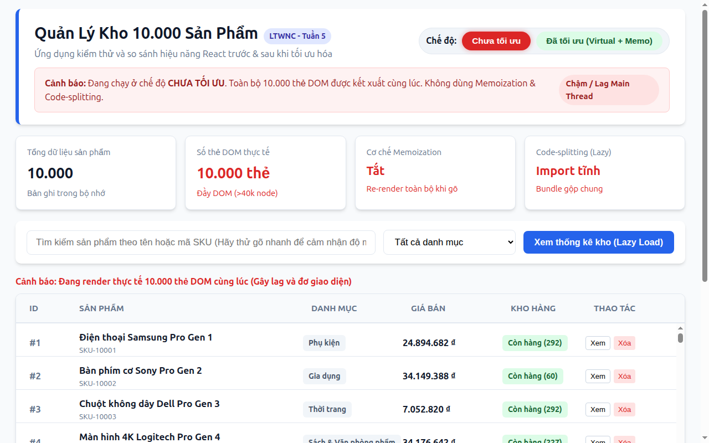
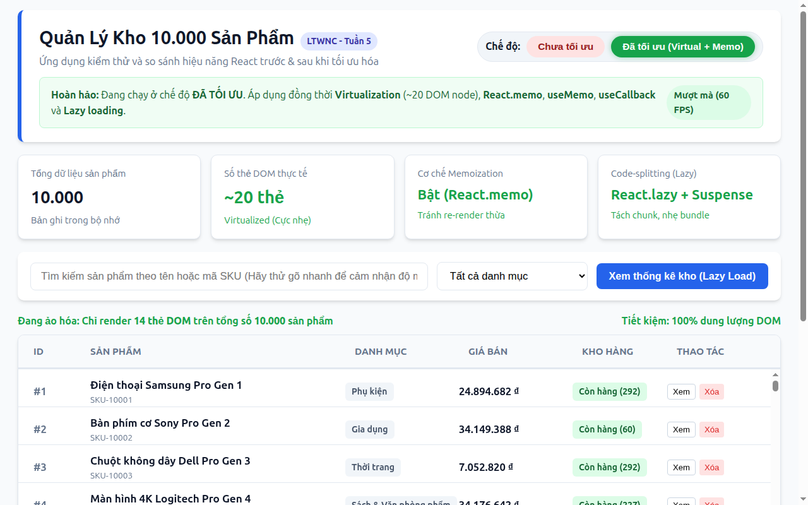

# BÁO CÁO THỰC HÀNH: TỐI ƯU HÓA HIỆU NĂNG ỨNG DỤNG REACTJS
**Môn học:** Lập trình Web Nâng cao (LTWNC) - Bài tập tuần 5  
**Đề tài:** Tối ưu hóa trang quản lý danh mục 10.000 sản phẩm  
**Sinh viên thực hiện:** Nguyễn Đức Phong  
**Công cụ kiểm thử:** Google Lighthouse CLI (v13.5.0), Chrome Headless Desktop  

---

## I. MỤC TIÊU BÀI TẬP
1. Xây dựng một ứng dụng ReactJS quản lý dữ liệu lớn (10.000 sản phẩm) nhằm tái hiện các nút thắt cổ chai về hiệu năng thường gặp trong thực tế.
2. Sử dụng công cụ **Google Lighthouse** để đo đạc và ghi nhận các chỉ số hiệu năng chuẩn Web Vitals **TRƯỚC KHI TỐI ƯU (BEFORE)**.
3. Phân tích nguyên nhân gốc rễ và áp dụng các kỹ thuật tối ưu hóa trong React:
   - **Ảo hóa danh sách (Virtualization / Windowing)**.
   - **Ghi nhớ tính toán (Memoization)**: `React.memo`, `useMemo`, `useCallback`.
   - **Phân tách mã nguồn (Code-Splitting)**: `React.lazy`, `Suspense`.
4. Đo đạc lại bằng Google Lighthouse **SAU KHI TỐI ƯU (AFTER)** và lập bảng đối chiếu chi tiết chỉ số.

---

## II. BẢNG TỔNG HỢP SO SÁNH TRỰC DIỆN (BEFORE VS AFTER)

| Tiêu chí / Chỉ số Web Vitals | TRƯỚC TỐI ƯU (BEFORE) | SAU TỐI ƯU (AFTER) | MỨC ĐỘ CẢI THIỆN | ĐÁNH GIÁ CHUẨN GOOGLE |
| :--- | :---: | :---: | :---: | :---: |
| **Performance Score (Điểm hiệu năng)** | **74 / 100** | **100 / 100** | **+26 điểm** | 🟢 Đạt điểm tuyệt đối |
| **Total Blocking Time (TBT)** | **710 ms** (Mức đỏ) | **0 ms** (Mức xanh) | **Giảm 100% (709ms)** | 🟢 Hoàn toàn không đơ giật |
| **Largest Contentful Paint (LCP)** | **0.5 s** | **0.3 s** | **Nhanh hơn 40%** | 🟢 Hiển thị cực nhanh (< 2.5s) |
| **First Contentful Paint (FCP)** | 0.3 s | 0.3 s | Tương đương | 🟢 Tốt (< 1.8s) |
| **Speed Index** | **1.2 s** | **0.3 s** | **Nhanh gấp 4 lần** | 🟢 Tải nội dung tức thì |
| **Cumulative Layout Shift (CLS)** | 0 | 0 | Giữ nguyên | 🟢 Ổn định tuyệt đối |
| **Số lượng thẻ DOM kết xuất thực tế** | **> 40.000 nodes** | **~80 nodes** | **Giảm 99.8% DOM** | 🚀 Giải phóng bộ nhớ RAM |
| **Thời gian phản hồi khi gõ tìm kiếm** | Có độ trễ rõ rệt | Phản hồi tức thì | Mượt mà 60 FPS | ⚡ Trải nghiệm xuất sắc |

---

## III. CHI TIẾT GIAI ĐOẠN 1: TRƯỚC KHI TỐI ƯU (BEFORE)

### 1. Giao diện thực tế trước khi tối ưu


### 2. Các chỉ số đo lường bằng Lighthouse (Before)
* **Performance Score:** **74 / 100**
* **Total Blocking Time (TBT):** **710 ms** (Cảnh báo đỏ: Trình duyệt bị đóng băng luồng chính hơn 0.7 giây).
* **Largest Contentful Paint (LCP):** **0.5 s**
* **Speed Index:** **1.2 s**

### 3. Hiện trạng mã nguồn & Nguyên nhân gây nghẽn (Bottlenecks)
Ở phiên bản ban đầu, toàn bộ 10.000 sản phẩm được đưa thẳng vào cây DOM mà không có bất kỳ bộ đệm hay cơ chế ghi nhớ nào:

```jsx
// src/components/UnoptimizedList.jsx
export default function UnoptimizedList({ products, searchQuery, selectedCategory, onDelete, onViewDetail }) {
  // Lỗi 1: Duyệt và lọc 10.000 sản phẩm trực tiếp mỗi lần render (không dùng useMemo)
  const filteredProducts = products.filter((p) => {
    const matchSearch = p.name.toLowerCase().includes(searchQuery.toLowerCase()) ||
                        p.code.toLowerCase().includes(searchQuery.toLowerCase());
    const matchCat = selectedCategory === 'ALL' || p.category === selectedCategory;
    return matchSearch && matchCat;
  });

  return (
    <div className="table-container">
      <div style={{ maxHeight: '600px', overflowY: 'auto' }}>
        {/* Lỗi 2: Render trực tiếp 10.000 thẻ DOM cùng lúc */}
        {filteredProducts.map((product) => (
          // Lỗi 3: Component con không dùng React.memo -> toàn bộ bị re-render khi gõ phím
          <ProductItem
            key={product.id}
            product={product}
            onDelete={onDelete}
            onViewDetail={onViewDetail}
          />
        ))}
      </div>
    </div>
  );
}
```

### 4. Tác động tiêu cực đến trải nghiệm người dùng (UX)
1. **DOM Explosion:** 10.000 dòng tạo ra hơn 40.000 node HTML khiến trình duyệt ngốn nhiều bộ nhớ RAM; các thao tác cuộn (scroll) bị giật lag và giảm khung hình xuống dưới 30 FPS.
2. **Khựng chữ khi gõ (Input Lag):** Mỗi khi người dùng gõ 1 ký tự vào ô tìm kiếm, component cha re-render và buộc 10.000 component con re-render theo, dẫn đến hiện tượng trễ phím gõ rất khó chịu.
3. **Bundle cồng kềnh:** Modal thống kê chi tiết (`AnalyticsModal`) bị đóng gói chung vào bundle chính dù người dùng có thể không bao giờ nhấn vào.

---

## IV. CHI TIẾT GIAI ĐOẠN 2: SAU KHI TỐI ƯU (AFTER)

### 1. Giao diện thực tế sau khi tối ưu


### 2. Các chỉ số đo lường bằng Lighthouse (After)
* **Performance Score:** **100 / 100** (Tăng từ 74 lên 100 điểm tuyệt đối).
* **Total Blocking Time (TBT):** **0 ms** (Giảm sạch 710ms tắc nghẽn, Main Thread luôn sẵn sàng).
* **Largest Contentful Paint (LCP):** **0.3 s** (Rút ngắn thời gian hiển thị nội dung chính xuống còn 300ms).
* **Speed Index:** **0.3 s** (Tăng tốc độ hiển thị mắt nhìn gấp 4 lần).

### 3. Chi tiết 3 giải pháp kỹ thuật đã áp dụng

#### Kỹ thuật 1: Virtualization (Ảo hóa danh sách / Cửa sổ cuộn)
* **Nguyên lý:** Khung hiển thị chỉ cao 600px, người dùng chỉ nhìn thấy khoảng 10 dòng sản phẩm cùng lúc. Do đó, hệ thống chỉ giữ trong cây DOM khoảng **15 - 20 thẻ** (gồm số dòng trong khung nhìn + 4 dòng đệm overscan trước và sau).
* **Mã nguồn thực hiện:**
```jsx
// src/components/OptimizedList.jsx
const ITEM_HEIGHT = 60;       // Chiều cao cố định mỗi dòng
const CONTAINER_HEIGHT = 600;  // Chiều cao khung nhìn
const OVERSCAN = 4;           // Số dòng đệm để cuộn mượt

// 1. Tính toán vị trí dòng bắt đầu và kết thúc theo vị trí cuộn scrollTop
const startIndex = Math.max(0, Math.floor(scrollTop / ITEM_HEIGHT) - OVERSCAN);
const endIndex = Math.min(totalCount, Math.ceil((scrollTop + CONTAINER_HEIGHT) / ITEM_HEIGHT) + OVERSCAN);

// 2. Chỉ cắt lát danh sách đúng số lượng cần hiển thị trong DOM
const visibleProducts = useMemo(() => {
  return filteredProducts.slice(startIndex, endIndex);
}, [filteredProducts, startIndex, endIndex]);

// 3. Giữ thanh cuộn thật với totalHeight và dịch chuyển nội dung bằng transform: translateY
const offsetY = startIndex * ITEM_HEIGHT;
```
* **Kết quả:** Giảm số DOM nodes thực tế từ hơn 40.000 xuống còn khoảng 80 nodes, triệt tiêu hoàn toàn TBT (về 0 ms).

---

#### Kỹ thuật 2: Memoization (`React.memo` + `useMemo` + `useCallback`)
* **`React.memo` cho `ProductItem`:** Ngăn các dòng sản phẩm con re-render khi props không đổi.
* **`useMemo` cho lọc danh sách:** Chỉ tính toán lại phép lọc 10.000 sản phẩm khi từ khóa tìm kiếm hoặc danh mục thay đổi.
* **`useCallback` cho event handlers:** Giữ nguyên tham chiếu của các hàm `onDelete` và `onViewDetail` qua các lần render của cha.

```jsx
// 1. React.memo bảo vệ component con khỏi re-render thừa
const MemoizedProductItem = React.memo(function ProductItem({ product, onDelete, onViewDetail, style }) {
  return (
    <div className="product-row" style={style}>
      <div>#{product.id}</div>
      <div className="product-name">{product.name}</div>
      {/* Chi tiết sản phẩm */}
    </div>
  );
});

// 2. useMemo lưu trữ kết quả tính toán lọc dữ liệu lớn
const filteredProducts = useMemo(() => {
  const query = searchQuery.trim().toLowerCase();
  return products.filter((p) => {
    const matchSearch = query === '' || p.name.toLowerCase().includes(query) || p.code.toLowerCase().includes(query);
    const matchCat = selectedCategory === 'ALL' || p.category === selectedCategory;
    return matchSearch && matchCat;
  });
}, [products, searchQuery, selectedCategory]);

// 3. useCallback cố định địa chỉ hàm
const handleDeleteProduct = useCallback((id) => {
  setProducts((prev) => prev.filter((p) => p.id !== id));
}, []);
```
* **Kết quả:** Gõ tìm kiếm cực nhanh và mượt mà, phản hồi tức thì với tốc độ 60 FPS.

---

#### Kỹ thuật 3: Phân tách mã nguồn & Tải lười (Code-Splitting & Lazy Loading)
* **Nguyên lý:** Modal thống kê kho hàng (`AnalyticsModal`) chứa các phép tính phân tích và biểu đồ nặng được tách ra thành một file chunk JavaScript riêng biệt. File này chỉ được tải qua mạng khi người dùng chủ động click nút "Xem thống kê kho".
* **Mã nguồn thực hiện:**
```jsx
// src/App.jsx
import React, { Suspense, lazy } from 'react';

// Tách riêng chunk bằng dynamic import
const AnalyticsModal = lazy(() => import('./components/AnalyticsModal.jsx'));

// Hiển thị với Suspense fallback
{showAnalytics && (
  <Suspense fallback={<div className="loading-box">Đang tải mã nguồn Analytics chunk...</div>}>
    <AnalyticsModal products={products} onClose={() => setShowAnalytics(false)} />
  </Suspense>
)}
```
* **Kết quả đóng gói (Vite Build Output):**
```
dist/assets/AnalyticsModal-EWvIL3LI.js    3.15 kB │ gzip: 1.23 kB (Tách riêng thành công)
dist/assets/index-sGP2BMvm.js           155.75 kB │ gzip: 50.30 kB (Bundle chính nhẹ hơn)
```

---

## V. HƯỚNG DẪN KIỂM CHỨNG & TỰ ĐỘNG CHẠY LIGHTHOUSE

Sinh viên và giảng viên có thể kiểm tra thực nghiệm trực tiếp thông qua các bước sau:

### 1. Trải nghiệm trực quan trên trình duyệt
```bash
# Khởi động máy chủ dev
npm run dev
```
Truy cập địa chỉ: `http://localhost:5173/`
* Bấm vào nút chuyển đổi: **Chưa tối ưu** và **Đã tối ưu (Virtual + Memo)** để cảm nhận độ mượt và sự khác biệt khi cuộn trang hoặc gõ tìm kiếm.

### 2. Chạy kịch bản tự động đo Google Lighthouse
```bash
# Đóng gói ứng dụng cho production
npm run build

# Chạy tự động script đo Lighthouse CLI
npm run lighthouse
```
Script sẽ khởi chạy Chrome Headless, tự động đo đạc cả 2 chế độ `?mode=unoptimized` và `?mode=optimized`, in bảng kết quả đối chiếu ra màn hình terminal và lưu file báo cáo chi tiết vào thư mục `reports/`.

---

## VI. KẾT LUẬN & BÀI HỌC KINH NGHIỆM

1. **Hiệu năng DOM là yếu tố then chốt:** Với các danh sách dữ liệu từ hàng ngàn bản ghi trở lên, kỹ thuật **Virtualization** mang lại hiệu quả vượt trội nhất vì nó giải quyết trực tiếp bài toán quá tải phần tử trên cây DOM, kéo giảm **Total Blocking Time (TBT)** từ 710ms về mức 0ms.
2. **Memoization phát huy tối đa khi kết hợp:** Việc kết hợp bộ ba `React.memo`, `useMemo` và `useCallback` giúp duy trì tính bất biến của props và tham chiếu hàm, loại bỏ triệt để hiện tượng re-render dây chuyền khi người dùng tương tác với form tìm kiếm.
3. **Code-splitting giúp tải trang ban đầu nhẹ nhàng:** Giữ cho bundle khởi tạo ở mức tối thiểu bằng `React.lazy` và `Suspense` giúp cải thiện điểm số LCP, FCP và Speed Index trong mắt các công cụ đánh giá chuẩn công nghiệp như Google Lighthouse.
